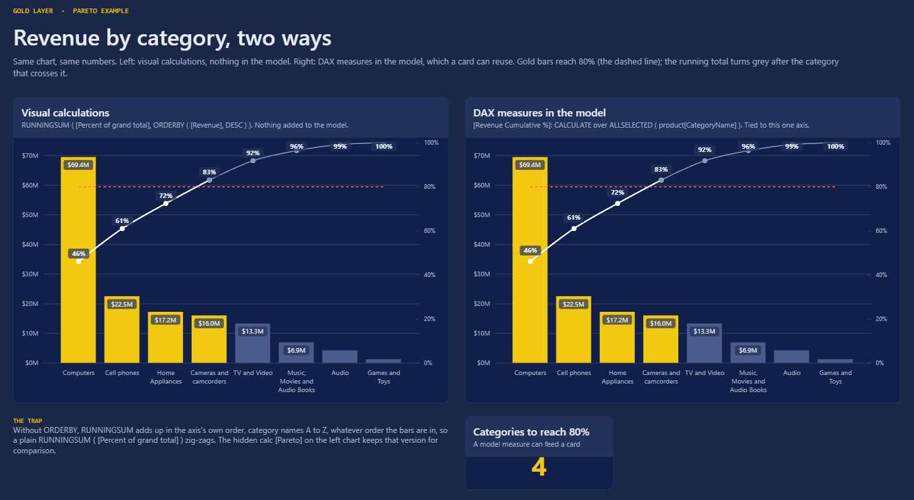

# Pareto in Power BI

A Pareto chart on the Contoso sample data, built two ways: with **visual calculations** and with **DAX measures**. Same numbers, different trade-offs. Plus shaded ABC zones, a cutoff you pick in a slicer, and the `RUNNINGSUM` trap.

- Article: [Pareto in Power BI: DAX measures or visual calculations?](https://goldlayerdata.com/post.html?slug=pareto-in-power-bi-dax-vs-visual-calculations)
- Short: [Pareto chart in Power BI in 4 steps](https://youtube.com/shorts/Lf9yYJ2yCX8)



## Open it

Download **`gold-layer-data-pareto.pbix`** and open it in Power BI Desktop. The data is inside the file, so it opens with no setup.

To refresh it against your own copy of the data, generate the dataset first (see [datasets/contoso](../../datasets/contoso)), then in Desktop go to Transform data > Edit parameters and set **DataFolder** to the `datasets\contoso\data\latest\` folder of your clone, with the trailing backslash. **AsOfDate** is "today", so a refresh shows the data up to the day you refresh it; type a date (yyyy-mm-dd) to freeze it.

## The numbers

Revenue by product category, as of 13 Nov 2026: $150.6M over 8 categories. Four of them (Computers, Cell phones, Home Appliances, Cameras and camcorders) make 83.0%, crossing 80% at the fourth.

## The pages

| Page | What it shows |
|---|---|
| README, Data dictionary | The shared Contoso model: tables, relationships, columns |
| Pareto | The same chart twice: visual calculations (left) and DAX measures (right), plus a card that counts the categories to 80% |
| Pareto · shaded | The vital-few zone and ABC bands, drawn as a second chart behind the first |
| Pareto · cutoff | Pick 50% to 95% in a slicer; the line, the bar colours and the count follow it |
| Pareto · trap | `RUNNINGSUM` without `ORDERBY` adds up A to Z by name, whatever the bar order: the chart and a table side by side |

## The formulas

All of them are in [`pareto.dax`](pareto.dax): the model measures (display folder *Pareto* on `sales`), the `Pareto Cutoff` table, and the visual calculations from the Pareto page. The one that does the work:

```dax
Cumulative % = RUNNINGSUM ( [Percent of grand total], ORDERBY ( [Revenue], DESC ) )
```

Leave out `ORDERBY` and the running total follows the axis's own order (category names A to Z), not the bars.

## Data

Contoso sample data from the [SQLBI Contoso Data Generator V2](https://github.com/sql-bi/Contoso-Data-Generator-V2) (MIT), run with our own settings. See [THIRD-PARTY-NOTICES.md](../../THIRD-PARTY-NOTICES.md).
